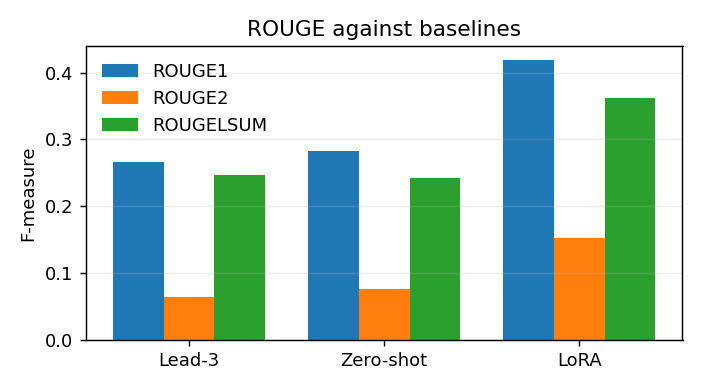

<p align="center">
  <a href="https://huggingface.co/emonHasan01/QwenSum-LoRA">
    
  </a>
  <a href="https://huggingface.co/Qwen/Qwen2.5-1.5B-Instruct">
    
  </a>
  
  
  <a href="https://huggingface.co/datasets/knkarthick/dialogsum">
    
  </a>
</p>


<div align="center">

[Hugging Face](https://huggingface.co/emonHasan01) | [GitHub](https://github.com/Md-Emon-Hasan) | [LinkedIn](https://www.linkedin.com/in/md-emon-hasan-695483237/) | [WhatsApp](https://wa.me/8801834363533) | [Portfolio](https://emonlabs-ai.hitechparks.com/)

**Author:** [Md. Emon Hasan](https://huggingface.co/emonHasan01)

</div>

# QwenSum-LoRA

LoRA adapter for [`Qwen/Qwen2.5-1.5B-Instruct`](https://huggingface.co/Qwen/Qwen2.5-1.5B-Instruct), trained on
[knkarthick/dialogsum](https://huggingface.co/datasets/knkarthick/dialogsum) for
abstractive dialogue summarization.

This repository contains **adapter weights only** (85 MB). It
does nothing without the base model.

| | |
|---|---|
| Trainable parameters | 18.5M (1.20% of the base) |
| Training examples | 6,000 |

## Usage

```python
import torch
from transformers import AutoModelForCausalLM, AutoTokenizer
from peft import PeftModel

base = AutoModelForCausalLM.from_pretrained(
    "Qwen/Qwen2.5-1.5B-Instruct", torch_dtype=torch.float16, device_map="auto")
model = PeftModel.from_pretrained(base, "emonHasan01/QwenSum-LoRA")
tok = AutoTokenizer.from_pretrained("emonHasan01/QwenSum-LoRA")

messages = [
    dict(role="system", content="You summarise conversations."),
    dict(role="user", content="Summarise the conversation below in two or three sentences. Write in the third person, name the speakers, and state only what the conversation says." + "\n\n" + your_dialogue),
]
prompt = tok.apply_chat_template(messages, tokenize=False, add_generation_prompt=True)
ids = tok(prompt, return_tensors="pt", add_special_tokens=False).to(model.device)
out = model.generate(**ids, max_new_tokens=96, do_sample=False)
print(tok.decode(out[0][ids["input_ids"].shape[1]:], skip_special_tokens=True))
```

The prompt format matters. The adapter was trained behind this exact chat template and
instruction string; a different wrapper will degrade it.

## Evaluation

250 held-out examples from the `test` split. Greedy
decoding, `max_new_tokens=96`, identical prompt for every system.

| System | ROUGE-1 | ROUGE-2 | ROUGE-Lsum | mean words |
|---|---|---|---|---|
| Lead-3 (first three turns, verbatim) | 0.2658 | 0.0646 | 0.2460 | 39.3 |
| Qwen/Qwen2.5-1.5B-Instruct zero-shot (same prompt) | 0.2822 | 0.0756 | 0.2424 | 49.4 |
| **This adapter** | **0.4185** | **0.1521** | **0.3624** | 24.6 |
| *(reference summaries)* | | | | *19.5* |

Change against the zero-shot base model: **ROUGE-1 +0.1362, ROUGE-2
+0.0765, ROUGE-Lsum +0.1200**. It improves on prompting the base model.

The zero-shot row is the comparison that matters. Beating lead-3 proves very little, since
the base model already does; the question is whether training beat *prompting the same
weights*.



### Is the gain just length?

Fine-tuned summaries are shorter than zero-shot ones (24.6 vs
49.4 words, against a reference mean of
19.5), and ROUGE F-measure rewards matching the
reference length. To separate that effect from real improvement, the base model was re-run
with a prompt asking for under 25 words, producing 27.9-word summaries —
close to the adapter's own length.

| Metric | Zero-shot | Zero-shot, length-matched | This adapter | share of gain from length |
|---|---|---|---|---|
| ROUGE1 | 0.2822 | 0.3014 | 0.4185 | 14% |
| ROUGE2 | 0.0756 | 0.0796 | 0.1521 | 5% |
| ROUGELSUM | 0.2424 | 0.2502 | 0.3624 | 7% |

Matching the length recovers only a small part of the gap. ROUGE-2 is the clearest case:
bigram overlap cannot be bought with length, and the adapter still scores roughly double
the length-matched baseline (0.1521 vs 0.0796).

### Behavioural checks

ROUGE is insensitive to several ways a summarizer can be bad, so these are measured
separately:

| | extractive copying | repetition | empty |
|---|---|---|---|
| Zero-shot | 0.000 | 0.000 | 0.000 |
| This adapter | 0.016 | 0.000 | 0.000 |

*Copying* is the share of summaries containing a 12-word span lifted verbatim from the
dialogue. *Repetition* flags outputs where fewer than half the words are distinct.

### Examples

**Reference**
> #Person1# and #Person2# talk about pilgrims around the world, including Muslims' pilgrimage to mecca and Christians' pilgrimage to Canterbury or Vatican. #Person2# thinks faith heals people instead of magical places.

**Zero-shot**
> The conversation discusses Islam, specifically the Hajj pilgrimage to Mecca by Muslim men. People visit for religious reasons but also because it can lead to health issues due to overcrowding and accidents. The speaker mentions other places like Lourdes where some believe healing occurs through faith.

**LoRA**
> #Person2# tells #Person1# it's a program about Islam. #Person2# explains that Muslims believe that every man who is able should go on a Haj at least once in his life. #Person2# also talks about the reasons why Muslim pilgrims go to Mecca and how many people go on the Haj each year.

**Reference**
> #Person1# is sending a package with the help of #Person2#.

**Zero-shot**
> #Person1# wants to send a package by first-class mail with insurance for $50 and additional stamps including a book of 22 and three airmails. #Person2# informs them they need to go to the stamp window on their right near general delivery for the stamps and money orders are available to the left, three windows down the hall.

**LoRA**
> #Person1# wants to send a package by first-class mail with insurance and some stamps. #Person2# tells #Person1# where to buy them.

**Reference**
> #Person1# invites Lily to picnic this weekend. Lily accepts.

**Zero-shot**
> Lily invites Person 2 to join them on a picnic at the river where they will have supper. Person 2 asks what they should bring and is told not to bring anything as everything will be provided.

**LoRA**
> Lily agrees to join #Person1#'s picnic at the river.

## Training

| | |
|---|---|
| Base model | `Qwen/Qwen2.5-1.5B-Instruct` (1.54B parameters, fp16, not quantized) |
| Method | LoRA (PEFT) |
| Rank / alpha / dropout | 16 / 32 / 0.05 |
| Target modules | `q_proj`, `k_proj`, `v_proj`, `o_proj`, `gate_proj`, `up_proj`, `down_proj` |
| Trainable parameters | 18.5M (1.20%) |
| Learning rate | 0.0002 (AdamW, cosine, 5% warmup) |
| Effective batch | 2 x 8 = 16 |
| Epochs / steps | 2 / 750 |
| Max sequence length | 768 (median 254) |
| Loss | computed on the summary only; prompt tokens masked to -100 |
| Precision | fp16 |
| Hardware | one NVIDIA T4 (16 GB), peak 6.3 GB |
| Seed | 42 |

Three choices worth stating. The learning rate is **0.0002**, roughly ten times a
full-fine-tuning rate, because far fewer parameters have to carry the same update — LoRA at
2e-5 barely moves. The loss is computed **only on the summary**: training on the prompt
tokens as well would spend most of the gradient learning to reproduce text the model is
always given. And the adapter parameters are held in fp32 while the base stays fp16, which
is what `GradScaler` needs in order to unscale gradients.

## Limitations

- **Faithfulness is not measured.** ROUGE does not check whether a summary is *true* of the
  dialogue. A hallucinated name, time, or amount scores well as long as the wording
  overlaps. Nothing here tests for that, so do not use this where a fabricated detail
  matters.
- **Domain.** Short, everyday two-party conversations in English. Meetings, many-speaker
  transcripts, domain jargon, and other languages are all out of distribution.
- **Input length.** Dialogues are truncated to about 560 tokens before the prompt is built.
  Longer conversations lose their endings, and the summary reflects that.
- **Single run.** One seed, one configuration. `r=16` was assumed rather than
  chosen, and no seed-variance estimate was made.
- **Prompt-coupled.** Trained behind one chat template and one instruction string. Treat
  those as part of the model.

## Citation

```bibtex
@inproceedings{chen2021dialogsum,
  title     = {DialogSum: A Real-Life Scenario Dialogue Summarization Dataset},
  author    = {Chen, Yulong and Liu, Yang and Chen, Liang and Zhang, Yue},
  booktitle = {Findings of ACL-IJCNLP 2021},
  year      = {2021}
}

@article{hu2021lora,
  title   = {LoRA: Low-Rank Adaptation of Large Language Models},
  author  = {Hu, Edward J. and Shen, Yelong and Wallis, Phillip and others},
  journal = {arXiv:2106.09685},
  year    = {2021}
}
```

---